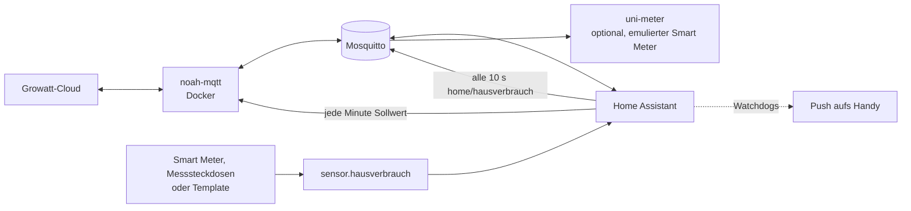

# NOAH-Nulleinspeisung mit Home Assistant

Regelt die Ausgangsleistung eines **Growatt NOAH 2000** (Balkonkraftwerk-Speicher) jede Minute
so, dass er ungefähr den aktuellen Hausverbrauch deckt und möglichst wenig ins Netz verschenkt.
Dazu kommen ein Schutz der Akkus vor Tiefentladung, eine Überwachung der Ladezustände zwischen
Haupt- und Zusatzakku und zwei Watchdogs, die aufs Handy melden, wenn die Regelung stehen bleibt.

Läuft seit Oktober 2026 auf einem Raspberry Pi mit Home Assistant, Mosquitto und Docker.

## Datenfluss

## Wie die Regelung rechnet

Jede Minute, wenn alle Werte verfügbar sind:

| Größe | Regel |
|---|---|
| Ziel | Hausverbrauch minus Puffer, mindestens 50 W |
| Puffer | 70 W bei SoC über 60 %, 90 W über 30 %, sonst 150 W |
| Obergrenze | 800 W, unter 20 % SoC nur 100 W, unter 15 % SoC 0 W (Tiefentladeschutz) |
| SoC | immer der **niedrigere** der beiden Akkus |
| Hysterese | neuer Sollwert nur, wenn er um mindestens 40 W abweicht |
| Akku-Drift | weichen die Akkus tagsüber um mehr als 6 % ab, wird auf 100 W gedrosselt und gemeldet |

Der Puffer lässt bewusst etwas Netzbezug zu. So deckt der Speicher den Grundverbrauch, ohne bei
jeder kurzen Lastspitze hinterherzuregeln und dabei ins Netz einzuspeisen.

### Beispiel

Hausverbrauch 420 W, Akkus bei 55 % und 58 %, Sonne scheint, letzter Sollwert 300 W:

1. SoC für alle Regeln ist der niedrigere Wert, also 55 %. Puffer daher 90 W, Obergrenze 800 W.
2. Ziel = 420 − 90 = 330 W, liegt zwischen 50 und 800 W.
3. Abweichung der Akkus 3 %, also keine Drosselung.
4. 330 W weichen nur 30 W vom letzten Sollwert ab, unter der Hysterese von 40 W. Es wird nichts gesendet.

## Bausteine

| Datei | Zweck |
|---|---|
| [homeassistant/automations.yaml](homeassistant/automations.yaml) | Regelung, Hausverbrauch per MQTT, zwei Watchdogs |
| [homeassistant/helpers.yaml](homeassistant/helpers.yaml) | benötigte Helfer und ein Beispiel für `sensor.hausverbrauch` |
| [docker/docker-compose.yml](docker/docker-compose.yml) | [noah-mqtt](https://github.com/mtrossbach/noah-mqtt) und optional [uni-meter](https://github.com/sdeigm/uni-meter) |
| [docker/uni-meter/uni-meter.conf.example](docker/uni-meter/uni-meter.conf.example) | emulierter Smart Meter aus dem MQTT-Topic `home/hausverbrauch` |
| [pi/noah-mqtt.service](pi/noah-mqtt.service) | systemd hält den Container am Leben |
| [pi/noah-mqtt-ensure.sh](pi/noah-mqtt-ensure.sh) | Neustart per SSH-Zwangsbefehl, aufrufbar aus Home Assistant |

noah-mqtt und uni-meter sind fremde Projekte. Sie werden hier nur als Docker-Image eingebunden,
ihr Code ist nicht Teil dieses Repos.

## Einrichtung

1. **noah-mqtt starten.** `docker/.env.example` nach `.env` kopieren, MQTT- und Growatt-Zugang
   eintragen, `docker compose up -d noah-mqtt`. Der NOAH erscheint per MQTT-Discovery in Home
   Assistant, mit Entitäten wie `sensor.noah_2000_bat0_soc` und `number.noah_2000_system_output_power`.
2. **Helfer anlegen** aus `helpers.yaml`, dazu einen Sensor `sensor.hausverbrauch` in Watt.
3. **Automationen einspielen** aus `automations.yaml`. Die Entitäts-IDs an die eigene Anlage
   anpassen, vor allem den Zusatzakku (`sensor.noah_2000_bat1_soc`, bei manchen Anlagen enthält die
   ID die Seriennummer) und den Benachrichtigungsdienst (`notify.mobile_app_mein_handy`).
4. Optional **uni-meter** mit der Beispielkonfiguration starten, wenn ein Gerät im LAN einen
   Smart Meter erwartet.
5. Optional den **systemd-Watchdog** und das **SSH-Skript** auf dem Docker-Host einrichten.

## Fehlerbehebung

| Symptom | Ursache und Lösung |
|---|---|
| Sollwert ändert sich stundenlang nicht | Normal, wenn der Akku an der Entladegrenze sitzt oder der Verbrauch innerhalb der Hysterese bleibt. Der Watchdog warnt deshalb nur, wenn der Akku über Entladegrenze plus 3 % liegt. |
| Automation läuft nie | Eine der Entitäten in der Bedingung „Alle Entitäten verfügbar“ ist `unavailable`. Unter Entwicklerwerkzeuge → Zustände prüfen, meist ist noah-mqtt nicht verbunden. |
| NOAH-Entitäten fehlen in Home Assistant | MQTT-Integration in HA einrichten und `docker logs noah-mqtt` auf Anmeldefehler an der Growatt-Cloud prüfen. |
| Ständiger Wechsel zwischen zwei Sollwerten | Hausverbrauch schwankt um die Hysterese. Hysterese auf 60 W erhöhen oder den Verbrauchssensor glätten. |

## Grenzen

- Die Daten kommen über die Growatt-Cloud, nicht lokal vom Gerät. Fällt die Cloud aus, steht
  die Regelung. Deshalb die Watchdogs.
- Neue Sollwerte wirken erst nach dem nächsten Abruf von noah-mqtt, die Regelung ist also
  bewusst träge und nicht für sekundengenaues Nachführen gedacht.
- Die Schwellen (15 %, 20 %, Puffer, 6 % Drift) sind Erfahrungswerte für diese eine Anlage,
  keine Herstellerangaben.

## Lizenz

MIT für die Dateien in diesem Repo, siehe [LICENSE](LICENSE).
